<!-- ═══════════════ HEADER ═══════════════ -->
<div align="center">



<h1>Subham Das</h1>

<a href="https://github.com/subhamdas29">
  
</a>

<br/>


</div>

---

---

## 👋 About Me

```ts
const subham = {
  role: "Backend Developer",
  education: "B.Tech CSE · Techno Institute of Engineering & Management (2026)",
  location: "Kolkata, India",
  focus: ["Distributed systems", "Event-driven architecture", "AI-powered apps"],
  certifications: "4× Google Cloud · 1× Coursera",
  dsa: "200+ problems on GeeksforGeeks (score 550+)",
  lookingFor: "Backend / SDE / Full-stack roles, internships & collaborations",
};
```

- 🔧 I build APIs, cloud-native tools and AI-powered apps, from schema design to deployment
- 🧩 Comfortable with microservices, Saga orchestration, real-time systems and async pipelines
- 🌱 Currently leveling up on **Next.js**, **RAG pipelines** and **Google Cloud / serverless**
- 🤝 Contributor to open source (see **Chess++** below)

---

## 🚀 Featured Projects

<table>
  <tr>
    <td width="50%" valign="top">

### 📄 [ResumePilot](https://github.com/subhamdas29/ATS_resume_matcher)
**AI-powered ATS resume analyzer** · Final Year Project (lead backend, team of 5)

Two-layer NLP pipeline (spaCy, custom NER, Groq, HuggingFace embeddings) with weighted ATS scoring across keyword match, semantic similarity, GitHub activity and job alignment. Async FastAPI backend cut API latency by **60%**.

`FastAPI` `spaCy` `Groq` `HuggingFace` `Supabase` `Docker` `React`

</td>
    <td width="50%" valign="top">

### 💸 [PayFlow](https://github.com/subhamdas29/Financial_management_app)
**Full-stack financial management app**

**29 REST endpoints** secured with JWT access/refresh rotation, bcrypt, Zod validation and RBAC. Atomic account-to-account transfers via Prisma `$transaction`, plus real-time over-budget alerts over authenticated per-user Socket.IO rooms.

`Node.js` `TypeScript` `Express` `PostgreSQL` `Prisma` `Socket.IO` `React`

</td>
  </tr>
  <tr>
    <td width="50%" valign="top">

### 🍔 [FoodRush](https://github.com/subhamdas29/food_delivery_app)
**Distributed food delivery platform** (UberEats / Swiggy-style)

Orchestrator-based **Saga** across 4 Node.js microservices with Kafka (KRaft) as the event bus. Crash-safe saga state, append-only audit log, and rollback unit-tested under a 30% simulated failure rate with **zero orphaned transactions**.

`TypeScript` `Kafka` `PostgreSQL` `Prisma` `Docker` `AWS EC2`

</td>
    <td width="50%" valign="top">

### ♟️ [Chess++](https://github.com/rajdeep131/ChessPlusPlus_web_app) · *open source contribution*
**Real-time multiplayer chess backend** for a custom variant

Architected the backend to hold **100 concurrent players at <1.3s move latency** with 100% reconnect/session recovery in load testing. Profiled and diagnosed a Redis matchmaking-queue bottleneck.

`Node.js` `FastAPI` `Socket.IO` `Redis` `PostgreSQL` `Prisma` `JWT`

</td>
  </tr>
</table>

<div align="center">

[](https://github.com/subhamdas29/ATS_resume_matcher)
[](https://github.com/subhamdas29/Financial_management_app)
[](https://github.com/subhamdas29/food_delivery_app)

</div>

---

## 🛠️ Tech Stack

<div align="center">

[](https://skillicons.dev)

[](https://skillicons.dev)

[](https://skillicons.dev)

[](https://skillicons.dev)

[](https://skillicons.dev)

[](https://skillicons.dev)

</div>

<details>
<summary><b>📚 Full breakdown</b></summary>
<br/>

| Area | Technologies |
|---|---|
| **Languages** | Python · TypeScript · JavaScript · Java · C |
| **Backend** | Node.js · Express.js · FastAPI · Socket.IO · JWT auth |
| **Messaging & Caching** | Kafka (KafkaJS) · Redis |
| **Databases / ORM** | PostgreSQL · MySQL · Supabase · Prisma |
| **AI / NLP** | spaCy · Groq · HuggingFace · embeddings |
| **Frontend** | React · Next.js *(learning)* · Tailwind CSS |
| **DevOps & Cloud** | Docker · GitHub Actions · AWS (EC2) · Google Cloud |
| **Tools** | Git · GitHub · Postman · VS Code |

</details>

---

## 🎯 Current Focus

| | |
|---|---|
| 🏗️ **Building** | Production-grade backend systems with FastAPI & Node.js |
| 🤖 **Exploring** | Generative AI in real apps: RAG pipelines, LangChain, vector databases |
| ☁️ **Deepening** | Google Cloud & serverless architecture |
| ⚛️ **Learning** | Next.js, from a backend developer's perspective |
| 🧠 **Practicing** | DSA & system design, keeping the GeeksforGeeks streak alive |

---

## 📊 GitHub Stats

<div align="center">


</div>

---

## 🐍 Contribution Snake

<div align="center">
  <picture>
    <source media="(prefers-color-scheme: dark)" srcset="https://raw.githubusercontent.com/subhamdas29/subhamdas29/output/github-snake-dark.svg" />
    <source media="(prefers-color-scheme: light)" srcset="https://raw.githubusercontent.com/subhamdas29/subhamdas29/output/github-snake.svg" />
    
  </picture>
</div>

---

## 🧠 Coding Profiles

<div align="center">

[](https://www.geeksforgeeks.org/profile/subhamdyyal)
[](https://github.com/subhamdas29)
[](https://github.com/subhamdas29)

</div>

---

## 🤝 Let's Connect

<div align="center">

I'm open to **backend / SDE / full-stack roles, internships and collaborations**. If you're building something interesting, say hi!

[](mailto:subhamdas5477@gmail.com)
[](https://www.linkedin.com/in/subham-das-270a92278)
[](https://github.com/subhamdas29)
[](https://www.geeksforgeeks.org/profile/subhamdyyal)


</div>
